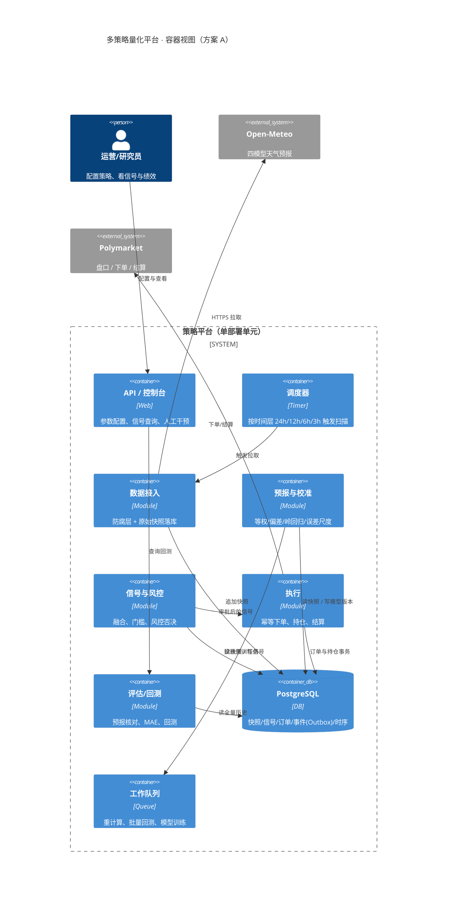

# 可扩展系统架构设计（初版）· ADR 驱动

> **适用范围与假设**（请确认，这决定后面所有取舍）
> 1. 本轮唯一可确认的业务事实是「复制 FMZ 680665 策略并长期发展」，因此我按**多策略量化信号 / 研究与执行平台**建模；如果实际是电商、SaaS 或内容平台，此文只保留方法论，容器划分需重做。
> 2. 团队规模假设为小到中等（1–2 个小组），尚未有明确的独立伸缩需求。
> 3. 强一致只要求出现在**资金/持仓/订单**边界；行情、预报、日志允许最终一致。
>
> 架构第一原则：**先让边界正确，再让服务数量正确**。过早拆微服务是这类系统最常见的不可逆错误。

---

## 1. 问题与约束

| 维度 | 约束 |
|---|---|
| 业务 | 把一个「天气概率 vs 预测市场盘口」的策略，从一次性脚本变成可参数化、可回测、可多策略并行、可审计的系统 |
| 数据 | 外部依赖强（Open-Meteo、Polymarket），有超时/缺失/限流；历史序列需可重放 |
| 一致性 | 下单、持仓、盈亏不可重不可丢；行情与信号可重算 |
| 可观测性 | 必须能回答「某笔信号为什么没下单」——这正是 680665 页面日志做得好的地方 |
| 演进 | 策略数量增长、新增市场/数据源、从模拟盘切实盘 |

## 2. 领域划分（限界上下文）

| 上下文 | 职责 | 聚合根 / 不变量 |
|---|---|---|
| 数据接入 Ingestion | 拉取并落库原始预报、盘口快照 | `MarketSnapshot`、`ForecastBatch`；**原始数据只追加、不覆盖** |
| 预报与校准 Forecasting | 等权中心、偏差校准、岭回归增强、误差尺度 | `ModelVersion`；模型版本必须与信号绑定，禁止"就地更新" |
| 信号 Signal | 概率分布、融合、组合候选、门槛判定 | `Signal`；每个信号必须记录完整输入快照与拒绝原因 |
| 风控 Risk | 当日亏损、连亏、回撤停机、确认次数 | `RiskState`；**否决权高于信号** |
| 执行 Execution | 下单/撤单/成交/结算 | `Order`、`Position`；幂等键 + 状态机 |
| 评估 Evaluation | 预报核对、MAE、回测、绩效归因 | `BacktestRun`；与实盘共用同一信号代码路径 |
| 审计 Observability | 结构化日志、指标、追踪 | 跨上下文关联 `trace_id` |

**关键领域事件**：`ForecastBatchReceived` → `SignalEvaluated` / `SignalRejected` → `RiskApproved` / `RiskVetoed` → `OrderPlaced` → `OrderFilled` → `PositionSettled` → `ForecastVerified`。

**上下文映射**：Signal 是下游，对 Ingestion/Forecasting 用**防腐层**（把外部字段翻译成内部 `ProbabilityDistribution`），避免 Open-Meteo 字段变动污染核心逻辑；Execution 对 Signal 是 Conformist（只认 `Signal` 的不可变快照）。

## 3. 两个方案与取舍

| | **方案 A：模块化单体 + 事件日志（推荐）** | **方案 B：按上下文拆微服务 + 消息总线** |
|---|---|---|
| 一致性 | 资金/持仓用单库事务，简单可靠 | 需 Saga / Outbox / 幂等，复杂度陡增 |
| 延迟与调试 | 进程内调用，一次 trace 可复现整条链路 | 跨服务追踪、时钟漂移、回放困难 |
| 独立伸缩 | 单进程整体扩容；重计算任务丢到工作队列 | 可单扩 Forecasting / Execution |
| 团队成本 | 1 个小组可控 | 需要平台工程 + 多套部署/监控 |
| 失败模式 | 单进程故障影响面大 | 单服务故障可隔离，但链路更长 |
| 适用阶段 | 策略数 < 几十、团队小、边界仍在变 | 多团队自治、明确需要独立发布与扩容 |

**结论**：选 A，但把「未来能拆」写进代码约束，而不是提前拆。拆分的触发条件必须是可观测的事实（例如某上下文 CPU/内存持续 > 60% 且发布节奏被互相阻塞），不是"感觉该拆了"。

## 4. ADR-001：以模块化单体起步，用 Outbox 预留事件化路径

- **Status**：Proposed（待确认）
- **Context**：业务边界仍在探索，强一致只集中在资金域，团队规模小；但需要长期支持多策略、多市场、回测与实盘一致。
- **Decision**：
  1. 单一部署单元，内部按上表 7 个上下文做**模块边界**（独立包/目录、只允许通过模块公开接口调用，禁止跨模块直接访问表）。
  2. 所有跨上下文协作写 `domain_events` 表（Outbox 模式），与业务事务同库同事务提交。
  3. 原始快照、信号、订单、模型版本全部**不可变追加**，任何时刻可回放。
  4. 策略参数（见 `strategy_680665_config.json`）外部化为版本化配置，`Signal` 记录所用配置版本。
  5. 回测与实盘共用同一个 `evaluate(snapshot, config)` 纯函数；回测只是换数据源。
- **Consequences（变容易 / 变难）**
  - 容易：一次部署、一次事务、端到端复现「为什么没下单」、参数改动可审计、将来按 Outbox 事件平滑拆服务。
  - 变难：单进程整体扩容；模块纪律靠 Code Review / 依赖检查维持，需要 CI 加一条"跨模块直连数据库"的静态检查；长期不拆会积累部署耦合。

## 5. C4 · 容器视图

## 6. 质量属性与具体手段

| 属性 | 手段 |
|---|---|
| 可靠性 | 外部接口超时/降级（680665 日志已证明 Open-Meteo 会 20s 超时）；四模型不齐则不产信号；Outbox + 幂等键；重放不产生重复订单 |
| 可维护性 | 模块接口 + CI 依赖检查；`evaluate()` 纯函数；配置版本化 |
| 可观测性 | 每个信号记录「输入快照 + 每项门槛的通过/拒绝原因」（复刻 680665 的日志格式）；指标：信号数、拒绝原因分布、模型 MAE、外部调用成功率 |
| 可扩展性 | 无状态 API + 队列承载重计算；快照按 `(market, date, layer)` 分区；拆服务边界与模块边界一一对应 |

## 7. 演进路线（不是时间承诺，按触发条件推进）

1. **阶段 1（立即可做）**：把 `strategy_680665_config.json` 变成第一份版本化策略配置；搭单库 schema + Outbox + 信号日志；先跑**模拟盘**并与 FMZ 实盘输出对齐。
2. **阶段 2（当第二个策略/第二个市场出现时）**：抽 `StrategyDefinition` 抽象，验证配置能否覆盖不同策略；把模型训练移进工作队列；补回测与实盘一致性校验。
3. **阶段 3（当某模块发布被互相阻塞或资源持续吃紧时）**：按 Outbox 事件把 Forecasting 或 Evaluation 拆成独立服务；其余保持单体。
4. **始终不做**：在没有多团队自治需求前拆 Execution（资金域拆分收益最低、风险最高）。

## 8. 需要你确认的输入（补齐后我出正式版）

1. 这个「大型软件系统」的实际业务域是什么？还是就以量化策略平台为准？
2. 团队规模、部署环境（自建 / 云）、是否已有数据库与语言栈？
3. 是否要实盘资金？合规与审计要求到什么程度？
4. 规模目标：策略数、市场数、日均事件量、延迟要求？
5. 现有代码资产是否已有模块划分或历史包袱？
